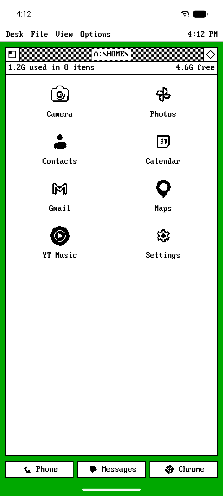
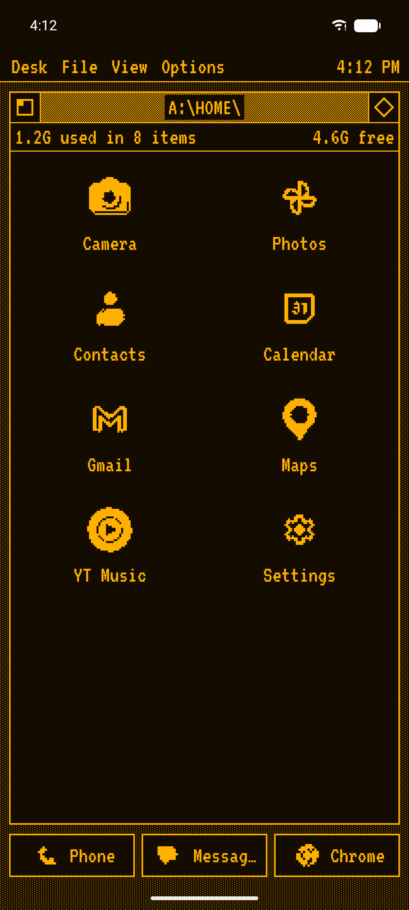
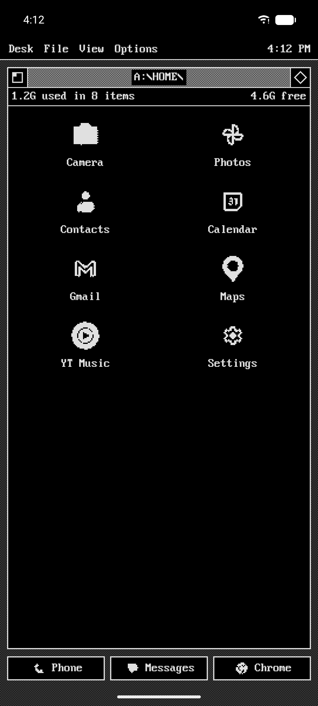
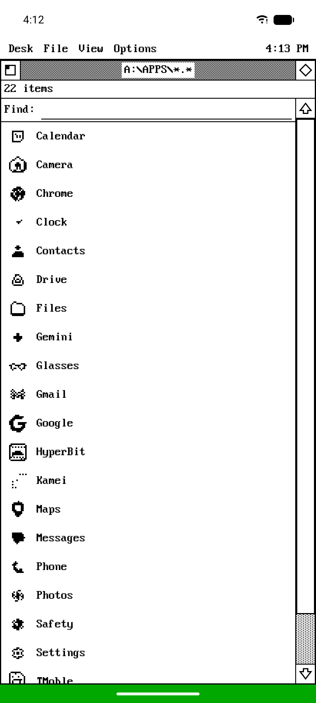

# OneBit Launcher

**Your home screen as a one-bit desktop from the 1980s: windows, menus, patterns and dithered icons.**

OneBit puts your apps in a classic monochrome desktop window, with a menu bar, a scroll bar, an info line and a taskbar. Every icon can be redrawn in one bit: pattern dithering, grain, line art or the app's own silhouette, or swapped for one of 2,000 bundled pixel icons.

<p>




</p>

## Features

- **Desktop.** A menu bar with a clock; a home window with boxed or striped chrome, an info line (storage, time, battery, item count) and real pages with a scroll bar; drag icons to move them; a zoom-rectangle launch animation.
- **Taskbar and drawer.** Zero to three taskbar buttons (hold one to assign it); swipe up for an app list with search; swipe down for notifications.
- **One-bit icons.** Pattern dither (each colour its own pattern, editable), 1-bit grain, line art, silhouette from the app's themed icon, pixel and 16-colour styles; icon packs (ADW/Nova format); any app's icon replaceable by a pixelarticons or Kenney 1-bit glyph.
- **Your look.** Eight presets, four colours to set yourself, twelve desk patterns, five pixel fonts, grid size, icon size and label placement, window size and position.
- **Your apps.** Rename, hide, app info and uninstall from each app's box; work-profile apps included.

## Install

- **GitHub:** download `OneBit-Launcher.apk` from the [latest release](https://github.com/AndSni/OneBit-Launcher/releases/latest) and open it
  (allow "install unknown apps"). Then press Home and pick OneBit.
- **F-Droid:** not submitted yet.

Requires Android 8.0 (API 26) or newer.

## Privacy

OneBit has no internet permission: it cannot connect anywhere. No account, no analytics, no ads, no tracking.

| Permission | Used for |
|---|---|
| Expand status bar | swipe down opens the notification shade |
| Request delete packages | Uninstall in an app's box |

## Building

```sh
./gradlew :app:assembleDebug        # debug build
./gradlew :app:testDebugUnitTest    # unit tests
```

Release builds are signed by CI from repository secrets; without a `keystore.properties` a
local `assembleRelease` produces an unsigned APK.

## Releasing

1. Bump `versionCode` and `versionName` in `app/build.gradle.kts`; add
   `metadata/en-US/changelogs/<versionCode>.txt`.
2. Commit and push to `main` (CI publishes a rolling `latest` pre-release).
3. Tag that commit `vX.Y.Z` and push the tag: `release-tag.yml` publishes the permanent release
   with `OneBit-Launcher.apk`, the file `.fdroid.yml`'s `Binaries` points at.
4. Pin the tagged commit's full hash in `.fdroid.yml` (`commit:`), bump `CurrentVersion`.

## Credits

- [pixelarticons](https://github.com/halfmage/pixelarticons) 2.4.2 by Gerrit Halfmann, MIT
- [Kenney 1-Bit Pack](https://kenney.nl/assets/1-bit-pack) 1.2, CC0
- Fonts: [Pixelify Sans](https://fonts.google.com/specimen/Pixelify+Sans), [Press Start 2P](https://fonts.google.com/specimen/Press+Start+2P), [Silkscreen](https://fonts.google.com/specimen/Silkscreen), [VT323](https://fonts.google.com/specimen/VT323) (SIL OFL 1.1); Px437 IBM VGA from VileR's [Ultimate Oldschool PC Font Pack](https://int10h.org/oldschool-pc-fonts/) (CC BY-SA 4.0)

## License

GPL-3.0. Copyright © 2026 AndSni. Bundled fonts and icons keep their own licences (texts in
`app/src/main/assets/licenses/`).
